### `> /whoami`

**AI & Data Science Student** · **Data Engineering** · **Cloud & MLOps**

## ⛏️ Player Info

Hi there! I'm **Yousra**, a Master's student in **Artificial Intelligence & Data Science** at the Faculty of Sciences and Techniques of Tangier, Morocco.

I enjoy taking projects **from an idea to a working system**: designing robust data pipelines, building useful AI applications, and making them accessible through thoughtful software.

- 🤖 **AI:** machine learning, NLP, generative AI, and retrieval-augmented generation.
- ⚙️ **Engineering:** event-driven architectures, data pipelines, analytics, APIs, and dashboards.
- ☁️ **Cloud:** deployment, automation, containers, and MLOps practices.
- 🎓 **Active quest:** looking for a **PFE internship in 2027** in AI, Data, or Cloud Engineering.

## 🎒 Inventory

**🪵 Languages & scripting**

   

**💎 AI, ML & GenAI**

    

**🟩 Data engineering & orchestration**

     

**🧱 Backend, cloud & DevOps**

     

## 🏆 Advancements Unlocked

### 📦 Automated Supply Chain Inventory Analytics Platform
**TE Connectivity · Data Engineering / Industrial Analytics**

Designed and implemented an industrial inventory analytics platform with **historical and real-time pipelines**, automated data processing, and interactive dashboards for blocked stock and inventory analysis.

`Python` `Kafka` `Prefect` `RabbitMQ` `Cassandra` `DuckDB` `ClickHouse` `Docker`

### ⚖️ Multilingual Legal AI Assistant
**Generative AI · NLP · Retrieval-Augmented Generation**

Built a multilingual legal assistant focused on **trustworthy, source-grounded answers**, evaluating retrieval and embedding strategies to improve the quality of responses.

`Python` `LLMs` `RAG` `Embeddings` `NLP`

### ☁️ Cloud-Deployed Sentiment Analysis
**Machine Learning · Cloud & CI/CD**

Containerized a sentiment-analysis service and deployed it on **Microsoft Azure**, using **GitHub Actions** for an automated build and release workflow.

`Python` `Docker` `Azure` `GitHub Actions`

## 🧭 Next Biomes to Explore

- AWS and cloud architecture patterns
- Production-ready LLM applications and MLOps
- Scalable real-time data systems
- AI systems that are reliable, explainable, and useful

## 🌍 Join My Server

Always happy to talk about **AI, data engineering, cloud, or interesting engineering challenges.**

